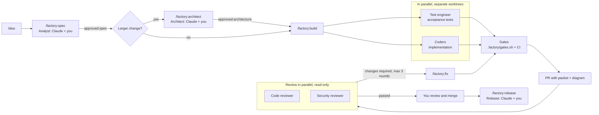

# Coding factory

A minimal, security-first agent team for building software with Claude Code, packaged as a plugin.

- **Agents:** a test engineer and coders working in parallel, plus a read-only code reviewer and a read-only security reviewer.
- **Deterministic gates:** lint, types, tests, build, Semgrep (SAST), gitleaks (secrets), Trivy (dependencies) and a PR description check, locally and in CI.
- **Humans decide:** you approve specs, architecture for larger changes, and every merge. Claude helps you as analyst, architect and release, through commands.
- **Tasks in GitHub Issues, specs and architecture notes in Notion.**



## Install

Prerequisites on your machine: Claude Code, the GitHub CLI (`gh auth login`), `jq` and `git`. For specs in Notion, connect the Notion MCP server once:

```
claude mcp add --transport http notion https://mcp.notion.com/mcp
```

Then, inside Claude Code:

```
/plugin marketplace add fjfj4/coding-factory
/plugin install factory@coding-factory
```

## Set up a product repo

Open Claude Code in the product repo and run `/factory:init` (or `/factory:init node` / `/factory:init python`). It creates:

| File | Purpose |
|---|---|
| `.factory/config.md` | Stack, Notion links, test folders, conventions. Read by every agent. |
| `.factory/gates.sh` | The gate commands. Agents can run it but not change it. |
| `.factory/check-pr-body.sh` | Checks the PR template is filled in. |
| `.github/workflows/factory-gates.yml` | The same gates in CI, plus Semgrep, gitleaks and Trivy. |
| `.github/pull_request_template.md` | The PR packet: why, what, diagram, verify, risk, checklist. |
| `.github/ISSUE_TEMPLATE/work-item.yml` | Work items with acceptance criteria. |
| `.github/CODEOWNERS` | Changes to gates and CI need your review. |
| `work/`, `docs/adr/`, `tests/acceptance/` | Spec snapshots, ADRs, acceptance tests. |

Then create the labels (`bash <plugin>/scripts/setup-labels.sh`, shown by `/factory:init`) and protect `main`: require a pull request, the `factory-gates` checks and code-owner review.

## Daily use

| Command | Role | What happens |
|---|---|---|
| `/factory:spec <idea>` | Analyst (Claude + you) | Spec in Notion, broken into GitHub issues with acceptance criteria |
| *you add* `approved:spec` | You | Approves the spec |
| `/factory:architect <issue>` | Architect (Claude + you) | Architecture note with threat model in Notion, for `needs:architecture` items |
| *you add* `approved:architecture` | You | Approves the architecture |
| `/factory:build <issue>` | Orchestration | Test engineer and coder in parallel, gates, PR, review |
| `/factory:review <pr>` | Code + security reviewers | Posts findings; never approves |
| `/factory:fix <pr>` | Coder | Fixes blocking findings, up to 3 rounds |
| *you merge* | You | Merging is always yours |
| `/factory:release` | Release (Claude + you) | Version and release notes; you publish |
| `/factory:status` | | Board of issues and PRs, and what's waiting for you |

## How the work is handed over

State lives in GitHub labels: `stage:spec → stage:architecture → stage:build → stage:review → stage:done`. When a build starts, the approved Notion spec and architecture note are frozen into `work/<issue#>-<slug>/`. The agents read those snapshots, so they never need Notion access. See the `factory-workflow` skill for the full contract.

## Security model

- **Separation of duties.** The test engineer writes acceptance tests from the spec without seeing the code; the coder can't change them, and the code reviewer checks that they weren't changed afterwards. Reviewers have no write or shell tools.
- **Guard hooks** (`plugins/factory/hooks/`) block Claude from merging, publishing releases, adding `approved:*` labels, pushing to `main`, force-pushing, skipping git hooks, reading `.env` and credential files, and changing CI workflows, gates or hooks.
- **Untrusted input.** Agents treat issue, PR, Notion and file content as data, and reviewers report attempts to instruct them.

**Limits, stated plainly.** The hooks match commands and paths. They're guardrails against mistakes, not a sandbox: a determined agent could get around them, for example by writing a script that does what a blocked command would. The real enforcement is on GitHub:

1. Protect `main`: require a PR, the `factory-gates` checks and code-owner review, and block force-pushes.
2. Keep `CODEOWNERS` on `.github/` and `.factory/gates.sh`.
3. For stronger separation, give Claude its own GitHub identity (a machine user or a fine-grained token) without admin rights. Then branch protection can require *your* approval on every PR it opens.

## Repository layout

```
.claude-plugin/marketplace.json     this repo is a plugin marketplace
plugins/factory/
  agents/        test-engineer, coder, code-reviewer, security-reviewer
  commands/      init, spec, architect, build, review, fix, release, status
  skills/        factory-workflow, writing-specs, architecture-notes, pr-packet, release-notes
  hooks/         guard hooks for Bash and file tools
  scripts/       init-product.sh, setup-labels.sh
  templates/     files /factory:init copies into a product repo
scripts/         validate.sh, check-pr-body.sh (for this repo's own CI)
tests/           tests for the hooks and the PR check
docs/decisions/  decisions about the factory itself
```

## Developing the factory

```
scripts/validate.sh   # plugin structure, frontmatter, read-only reviewers
tests/run.sh          # hook and PR-check tests
```

Both run in CI on every PR. Changes to agents, skills or hooks go through a PR like any other code.

## Not yet included

Readiness evaluator, product analyst, architect and planner agents, QA, release and SRE agents, the improvement loop and the orchestrator. Today those roles are you and Claude in the main session.
