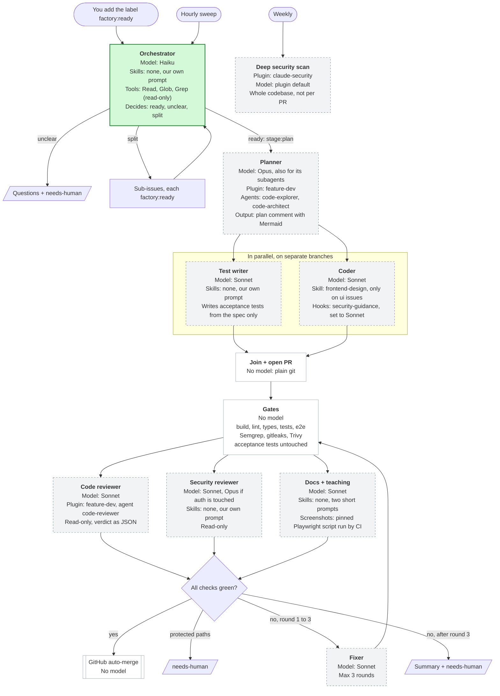

# The factory at a glance

Every stage of Coding Factory v2, the model it runs on, and the plugins, skills and tools it gets. Source: [plan](../plan-v2.md) and [ADR 0003](../decisions/0003-autonomous-factory-v2.md). Solid green boxes are built; the rest are planned.

## Summary table

| Stage | Model | Plugins, skills, hooks | Can write? | Status |
|---|---|---|---|---|
| Orchestrator | Haiku | Our own prompt | No (labels set by a script) | Built |
| Planner | Opus |  `feature-dev`: `code-explorer`, `code-architect` | Comments only | Planned |
| Test writer | Sonnet | Our own prompt | Tests only | Planned |
| Coder | Sonnet | `frontend-design` (ui issues), `security-guidance` hooks | Yes | Planned |
| Join, gates, merge | None | Plain CI | n/a | Gates reused from v1 |
| Code reviewer | Sonnet | `feature-dev`: `code-reviewer` | No | Planned |
| Security reviewer | Sonnet, Opus on auth | Our own prompt | No | Planned |
| Docs + teaching | Sonnet | Our own prompts, Playwright script in CI | Docs only | Planned |
| Fixer | Sonnet | Same as coder | Yes | Planned |
| Deep security scan | Plugin default | `claude-security`, weekly | No | Planned |

Only one stage uses Haiku. Only the planner uses Opus every time; the security reviewer uses it when auth code changes. Most steps use no model at all, which keeps runs cheap and predictable.
