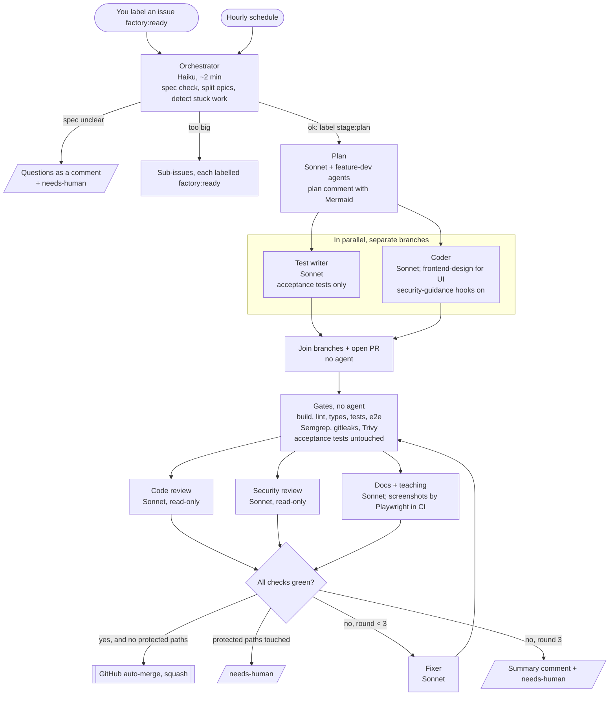
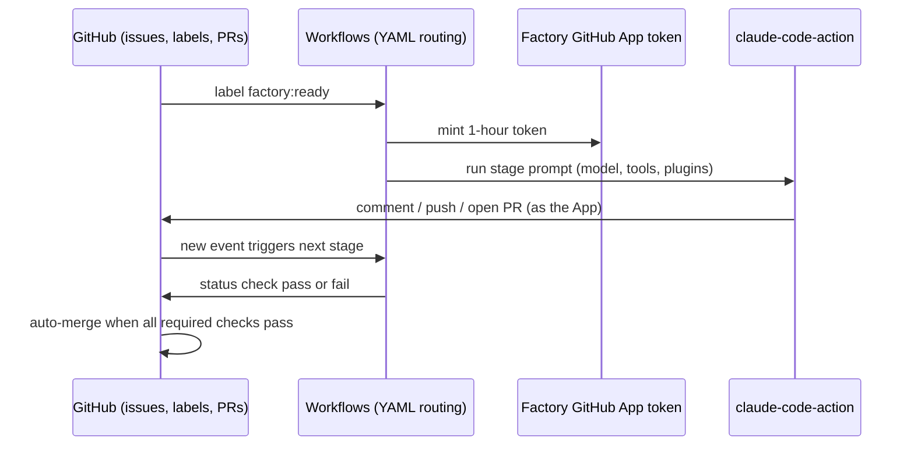

# Coding Factory v2: the plan

**Status:** Approved by Jacob on 2026-11-20, with the answers below. Decision recorded in [ADR 0003](decisions/0003-autonomous-factory-v2.md).
**Date:** 2026-11-20
**Brief:** [brief-v2.md](brief-v2.md)

## In one paragraph

You label an issue `factory:ready`. A small orchestrator checks that the issue is buildable, then GitHub Actions runs each stage as its own job: plan, tests and code in parallel, deterministic gates, two read-only reviews, docs and a teaching page. Every stage reports a pass or fail **status check**. Branch protection requires all of them, and GitHub's own auto-merge merges the PR when they are green. A label-driven fix loop gets three tries, then hands the issue to you with `needs-human`.

## The pipeline

## How the pieces talk to each other

Labels hold the state (`stage:plan`, `stage:build`, `stage:review`, `fix-round:1..3`, `needs-human`). YAML does all routing. No stage reads another stage's chat, only files and comments on GitHub.

## Components I chose, and why

| Stage | Component | Why this one | Size check |
|---|---|---|---|
| Runner | `anthropics/claude-code-action` (pinned SHA), `plugins:` input from `claude-plugins-official` | Official, actively maintained (Claude Code 2.1.329 bumped yesterday), supports your OAuth token and structured JSON output | n/a |
| Orchestrator | Our own prompt, ~250 words, Haiku | Nothing maintained fits. It only reads and labels. | small |
| Plan | `feature-dev` plugin, **only its `code-explorer` and `code-architect` agents** | Both are Sonnet and short. I skip the `/feature-dev` command itself: it is interactive and stops to ask you questions, which breaks headless runs. | 568 words |
| Test writer | Our own prompt, ~250 words | No maintained "write tests from acceptance criteria" agent exists. | small |
| Coder | Built-in Claude Code + `frontend-design` skill on UI issues only + `security-guidance` hooks | The hooks warn on dangerous patterns as code is written and review the diff before the run ends, so many security bugs are fixed before review. | skill 1,505 words, loaded only for `ui` issues |
| Gates | v1's `factory-gates.yml` (Semgrep, gitleaks, Trivy, SHA-pinned) + new e2e and "acceptance tests untouched" checks | Deterministic, free, already tested in v1 | n/a |
| Code review | `feature-dev`'s `code-reviewer` agent, one Sonnet run, verdict as JSON | See "Pushback" 3: the `code-review` plugin is far too heavy per PR | 424 words |
| Security review | Our own short read-only prompt (trimmed v1 agent), Sonnet; Opus when the diff touches auth | See "Pushback" 4 | ~300 words |
| Deep security scan | `claude-security` plugin, weekly, not per PR | It is large (~30k words of skills and agents) and built for whole-codebase scans | weekly only |
| Docs + teaching | One Sonnet run with two short prompts; screenshots come from a pinned Playwright script that CI runs | See "Pushback" 5 | small |
| Merge | GitHub native auto-merge (squash) | No agent needed | n/a |

**What goes from v1:** the four custom agents (replaced as above), the human approval labels, `/factory:spec`, `/factory:architect`, `/factory:release` (release becomes a later, optional workflow), the local guard hooks (in Actions the App's permissions and branch rules do that job), and `board.sh`'s 1,300 lines (stage labels plus GitHub Projects' built-in workflows replace it).
**What stays:** gate templates, the PR template with "Visualize the change", `.gitattributes`, Dependabot cooldown, the tests for anything kept, ADRs 0001 and 0002 as history. ADR 0003 records the move.

## Pushback and changes to your brief

1. **Use our own small GitHub App, not a PAT.** The official Claude App can't edit workflows (good), but its token only exists inside the action, so YAML steps can't use it to label and chain stages. A fine-grained PAT is a long-lived secret tied to you. A "factory" GitHub App mints a token that lives one hour, can't touch `.github/workflows/`, and its events do trigger the next workflow. Setup is one manifest click plus two secrets.
2. **Your OAuth token works, with one catch.** `claude-code-action` officially supports `CLAUDE_CODE_OAUTH_TOKEN`. But every factory run counts against the same usage limits as your own Claude use, so a busy day of factory runs can rate-limit you, and vice versa. Your account is on Pro, which fits only a few features per five-hour window. Every component I chose works with the OAuth token, except `claude-code-security-review`, which needs an API key and hasn't been updated since February. I've dropped it.
3. **Don't use the `code-review` plugin per PR.** Each run launches 8 or more subagents, including two Opus reviewers plus an Opus validator per finding. It also skips any PR Claude has already commented on, so it would silently not re-review after a fix round. The `pr-review-toolkit` is lighter but still six agents (~5,000 words). One Sonnet run with `feature-dev`'s reviewer gives a clear pass/fail at a fraction of the cost.
4. **`security-guidance` is not a reviewer.** It's now a set of hooks (a few hundred KB of Python) that review code while Claude writes it. That's valuable in the coder run, so I put it there, set to Sonnet instead of its default Opus. The per-PR security gate still needs a separate read-only reviewer, so that one stays our own short prompt.
5. **Screenshots from a script, not the Playwright MCP.** The marketplace's Playwright plugin runs `@playwright/mcp@latest`, which is unpinned (a supply-chain risk, against your own "pin everything" rule), and driving a browser through an agent costs many tokens per click. Instead, the docs agent writes a short Playwright script; CI runs it with a pinned version, saves the PNGs, and the same script doubles as an end-to-end test.
6. **Mobile screenshots: Expo web build first.** If the mobile apps are React Native/Expo, a web build plus the same Playwright script is fast (~2 min) and reliable. An Android emulator in Actions works but adds 5 to 10 minutes per run and is flaky. iOS needs paid macOS runners. I'd start with Expo web and add the emulator only for screens that can't render on the web.
7. **Tests and code in parallel, on two branches.** If both agents push to one branch they collide. Each gets its own branch; a plain git step joins them (their files don't overlap), and a gate fails the PR if the coder changed any acceptance test. This keeps v1's best idea: the tests are written from the spec, not from the code.
8. **Add to the never-auto-merge list:** new or upgraded dependencies (the largest supply-chain risk), `CODEOWNERS`, Dockerfiles and infrastructure files, and `.claude/` or `CLAUDE.md` (which steer the agents themselves). Dependabot's own PRs could still auto-merge after the cooldown.
9. **Hard limits on every run:** a turn cap and a job timeout per stage, and the orchestrator stops an issue after a token budget. That turns a runaway loop into a `needs-human` label instead of a burned weekly limit.

## The honest outside view

- **Agents reviewing agents share blind spots.** The coder and both reviewers are the same model family reading the same spec. They catch different bugs than a human, not all bugs. The deterministic gates and good acceptance tests are what make auto-merge safe, so the factory is only as good as the acceptance criteria you write. That is now your most important job as PM.
- **"Merged" is not "correct".** Auto-merge proves the tests pass, not that the feature is what users wanted. I suggest auto-merge to `main` but a deploy step you control, at least at first.
- **Calibrate before trusting.** I'd run the first ten or so issues with auto-merge switched off (one setting), compare what you would have rejected, then switch it on. That costs you ten clicks and tells you whether the factory deserves the trust.
- **Most of the value is boring YAML.** Only five stages need an LLM. Routing, gates, joins, merges and screenshots are plain CI, which is cheaper, faster and fully predictable. That's deliberate.

## Estimated token cost for one small feature

| Stage | Model | Input tokens | Output tokens |
|---|---|---|---|
| Orchestrator | Haiku | 20k | 1k |
| Plan | Sonnet | 150k | 8k |
| Test writer | Sonnet | 100k | 6k |
| Coder (+ security hooks) | Sonnet | 450k | 25k |
| Code review | Sonnet | 80k | 3k |
| Security review | Sonnet | 80k | 3k |
| Docs + teaching | Sonnet | 100k | 8k |
| One fix round (average) | Sonnet | 150k | 10k |
| **Total** | | **~1.1M** | **~65k** |

Most input is cached re-reads of the same files, which cost far less than fresh input. These are estimates from similar runs; the end-to-end demo will report the real numbers from each run's usage log.

## Build order (small PRs)

1. ADR 0003, delete the v1 pieces, keep the tests green.
2. Factory GitHub App manifest + the orchestrator workflow, with a dry-run mode.
3. Plan stage, then test writer and coder in parallel, then the join and PR.
4. Gates (mostly v1) + review and security review checks.
5. Fix loop and auto-merge, with protected-path detection.
6. Docs + teaching stage with Playwright screenshots.
7. End-to-end demo on a tiny web app repo, with real token usage.
8. README: install, secrets, branch-protection clicks, how to read the board.

## Answers (2026-11-20)

1. **Demo repo:** yes. It will be public, `fjfj4/factory-demo`, so branch protection works on GitHub Free.
2. **Mobile stack:** Expo (React Native with TypeScript), as recommended. Screenshots come from its web build.
3. **Public or private:** public is fine for the demo and hobby apps. Products that might be sold should be private on a paid GitHub plan. Agents only read comments from the owner and the factory.
4. **Never-auto-merge additions:** accepted.
5. **Claude plan:** the account is on Pro. Prove the factory on Pro, then choose Max or a separate API key for real use.
