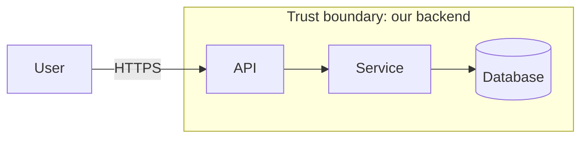

# ADR: <title>

**Status:** Proposed | Approved | Superseded by <link>
**Issue(s):** #<n>
**Spec:** <Notion link>

## Context
<What forces this decision. Constraints from the spec.>

## Decision
<What we will do, in a few sentences.>

## Design

- **Components and responsibilities:** <…>
- **Interfaces:** <endpoints, events, function signatures, error codes>
- **Data model changes:** <tables/fields, migrations, how to roll back>

## Threat model (STRIDE)
| Entry point / boundary | Threat | Mitigation (must be implemented) |
|---|---|---|
| <POST /orders> | Elevation of privilege: user edits another user's order | Check ownership in the service layer; deny by default |

## Alternatives considered
- <Option> — rejected because <reason>

## Consequences
<What gets easier or harder. Follow-up work.>
